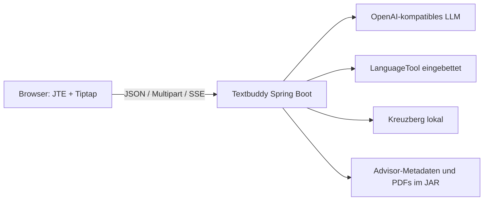

# Architektur

## Aufbau

Textbuddy ist eine einzelne Spring-Boot-Anwendung für einen zentral betriebenen Team-Server. Es gibt keine Datenbank und keinen verteilten Anwendungszustand. Diese Begrenzung ist Absicht: Deployment, Fehlersuche und Weiterentwicklung sollen ohne zusätzliche Infrastruktur verständlich bleiben.

- `web`: HTTP-Verträge, Eingabegrenzen, Fehlerabbildung und Startseite.
- Fachpakete wie `quickaction`, `textcorrection`, `advisor` und `document`: kleine Services und unveränderliche Request-/Response-Typen.
- `integration`: Provider-Adapter. Alle LLM-Funktionen hängen an genau einem `TextbuddyLlmClient`.
- `config`: ein Konfigurationsaggregat (`TextbuddyProperties`) und die Auswahl der Adapter.
- `frontend`: eine TypeScript-/Tiptap-Insel; keine zweite eigenständige Webanwendung.

## HTTP-Verträge

| Endpoint | Format | Zweck |
| --- | --- | --- |
| `POST /api/text-correction` | JSON | Rechtschreib- und Stilhinweise |
| `POST /api/quick-actions/plain-language`, `POST /api/quick-actions/summarize` | JSON | Volltext-Überarbeitung oder Zusammenfassung |
| `GET /api/advisor/docs` | JSON | Statischer Advisor-Katalog |
| `GET /api/advisor/doc/{name}` | PDF | Referenzdokument für einen neuen Browser-Tab |
| `POST /api/advisor/validate` | SSE | Regelprüfung mit Befunden, Batchfortschritt und Abschlussereignis |
| `POST /api/advisor/fix` | JSON | Ein Ersatztext pro ausgewählter Fundstelle in Reihenfolge des Requests |
| `POST /api/convert/doc` | Multipart/JSON | Extrahierten Dokumenttext als `{"text": "..."}` liefern |

Die Advisor-Prüfung verarbeitet Regeln in Dreierbatches. Das SSE-Abschlussereignis `complete` enthält `truncated: true`, wenn die Regel- oder Befundgrenze Ergebnisse begrenzt. Ein Stream ohne gültiges Abschlussereignis gilt als fehlgeschlagen.

LanguageTool und Advisor liefern halb offene UTF-16-Bereiche im unveränderten Request-Text. Der Advisor übernimmt exakt kopierte Fundstellen aus gültigen Regeln. Bei Wiederholungen muss ein exakt kopierter Kontext die Stelle eindeutig bestimmen. Für Korrekturen übermittelt der Editor geordnete, disjunkte Bereiche mit ihrem Originalausschnitt. Der Server prüft Textausschnitt und Regel und fordert pro Bereich einen Ersatztext an. Der Editor bindet die Vorschau an den geprüften Textstand und übernimmt die ausgewählten Ersetzungen als eine Undo-Transaktion.

Kreuzberg liefert direkt Text und Absatzumbrüche. Der Ergebnis-Cache ist deaktiviert. Der Editor setzt Text als Tiptap-Textknoten ein und verwendet LF als Zeilenumbruch. DOCX exportiert jede Editorzeile als Absatz.

## Zustand und Daten

- Advisor-Metadaten und PDFs werden beim Start einmal aus dem Klassenpfad geladen. Alle angemeldeten Benutzer sehen denselben Katalog.
- Die mitgelieferten Advisor-Dokumente sind projektinterne Demo-Regelwerke. Eigene Regelwerke werden als geprüftes JSON-/PDF-Paar in das Artefakt gebaut; Runtime-Uploads und Persistenz existieren nicht.
- Das persönliche Wörterbuch liegt ausschliesslich in `localStorage` des Browsers. Es gibt keine Synchronisierung oder Serversicherung.
- Bearbeitete Texte und hochgeladene Dokumente werden nicht dauerhaft gespeichert.
- Provider- und Netzwerkadapter führen keine automatischen Wiederholungen aus. Einzige Ausnahme ist der lokale OCR-Adapter: Scheitert eine explizit gewählte Nicht-Standardsprache an einem OCR-Fehler, versucht er die Erkennung einmal mit der Standardsprache.

## Sicherheitsgrenzen

Im Produktionsmodus sind nur Login, Fehlerseite und statische Assets öffentlich; alle übrigen Routen verlangen eine OIDC-Anmeldung. Zustandsändernde Browseranfragen tragen ein CSRF-Token. Ein ungeschützter Start ist nur bei expliziter Loopback-Bindung möglich. Upload-, Text- und Promptgrössen werden vor teurer Verarbeitung geprüft. CSP und `X-Frame-Options: SAMEORIGIN` erlauben eigene PDF-Ressourcen, aber keine fremde Einbettung.

Externe Provider sind eine eigene Datenschutzgrenze: Für LLM-Funktionen erforderliche Texte verlassen den Textbuddy-Prozess. Die Entscheidung dafür und die Aufbewahrungsregeln des Providers gehören zur Betriebskonfiguration.
